<h1 align="center">Halo for MS-DOS and Windows 95</h1>

<p align="center">
Halo: Combat Evolved, running on MS-DOS and Windows 95, from a Pentium 133 to today's PCs.<br>
Software rendering in 256 colours or full colour, OpenGL, Direct3D 8 and the 3dfx Voodoo.<br>
Campaign, split screen, bots, Firefight, and online play with ChupathingyCE, OpenCE and Halo Custom Edition players.
</p>

<p align="center">
<a href="https://github.com/JackTulli/halo-dos/releases/latest"><b>Download</b></a> ·
<a href="https://jacktulli.github.io/halo-dos/">Website</a> ·
<a href="#installing">Installing</a> ·
<a href="#playing-online">Playing online</a> ·
<a href="#building-from-source">Building from source</a>
</p>

<p align="center">
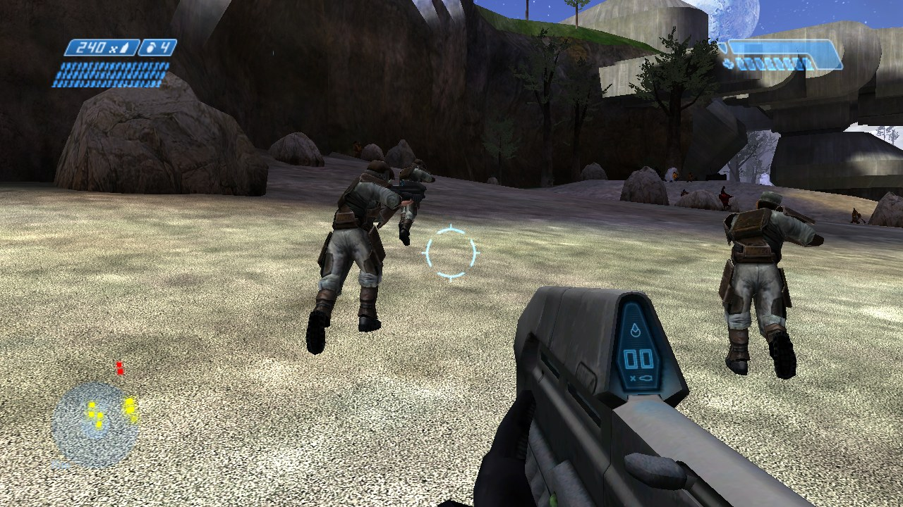
</p>

> **A fan project.** It isn't made, endorsed or supported by Microsoft, Bungie or 343 Industries.
> Halo is a trademark of Microsoft. **No game data comes with it:** you need your own copy of
> Halo: Combat Evolved for the original Xbox, whose maps the game plays.

## What it is

Two programs built from one set of game objects:

| | |
|---|---|
| **`HALO.EXE`** | MS-DOS. 32-bit protected mode through the built-in DOS/32A extender: nothing else to load. VGA 320x200 in 256 colours, or VESA 2.0 modes up to full colour. Sound Blaster, game-port joysticks, a packet-driver network stack (mTCP), and a driver of its own for the 3dfx Voodoo Graphics. |
| **`HALO95.EXE`** | Windows 95, 98 and Me, and every Windows since (it runs on Windows 11). The same software renderer, or the graphics card through OpenGL 1.1 or Direct3D 8. Up to four controllers (XInput or any Windows joystick), wave-out sound, Winsock 1.1. |

The game itself is [ChupathingyCE](https://github.com/ChupathingyCE/chupathingyce)'s (version 0.8.0d),
the source port of Halo that grew out of halo-ce-universal. This repository adds a C runtime that
runs on DOS and Windows 95, a renderer of its own, the DOS and Windows 95 platform layers, a
menu and HUD drawn with the game's own art, and a client for Halo Custom Edition servers.

## Screenshots

### Three renderers

The same moments in each renderer, at 1280x720. **Software** is what DOS draws (here in full colour).
**OpenGL** and **Direct3D 8** draw on the graphics card. Direct3D 8 can also draw as the Xbox did,
with Halo's own lightmaps, lit objects and its texture pass for the detail maps and skies.

<table>
<tr><th>Software</th><th>OpenGL</th><th>Direct3D 8 (Xbox look)</th></tr>
<tr>
<td>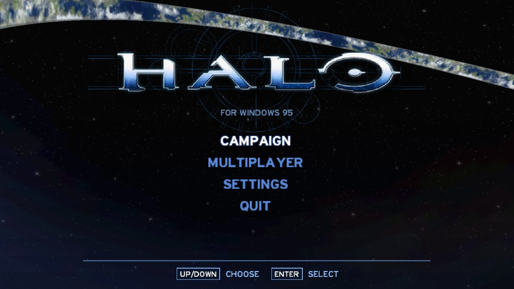</td>
<td>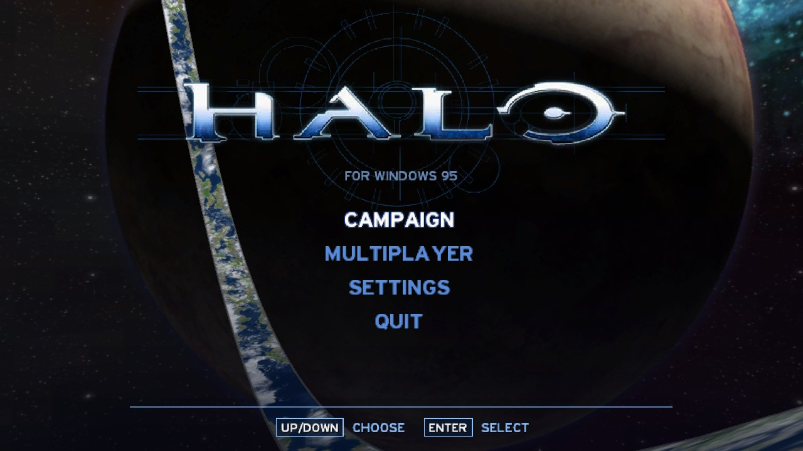</td>
<td>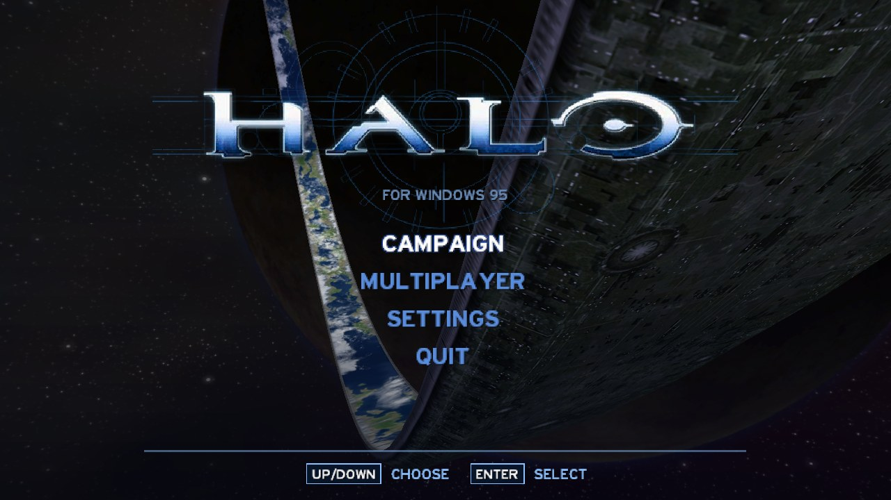</td>
</tr>
<tr>
<td>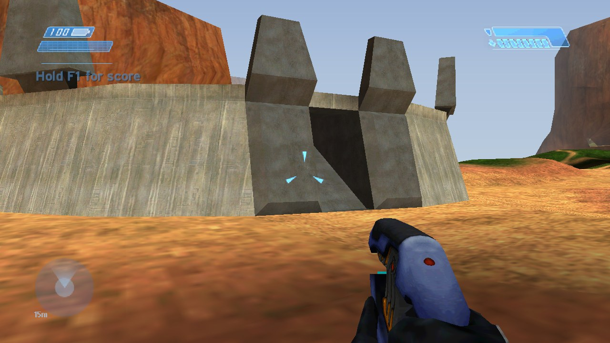</td>
<td>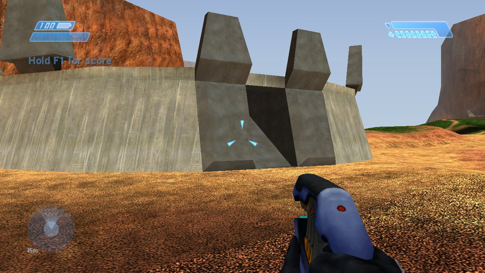</td>
<td>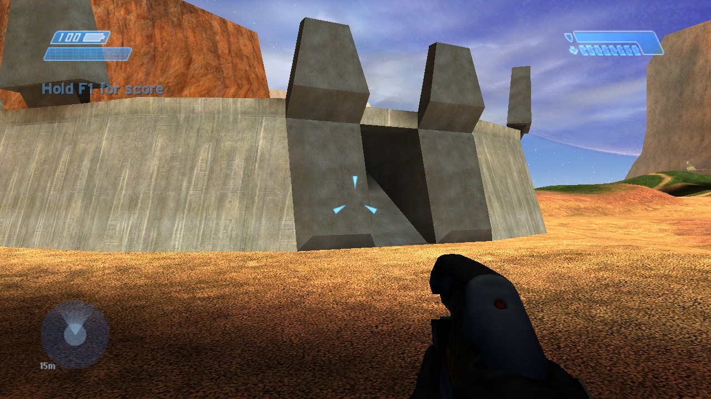</td>
</tr>
<tr>
<td>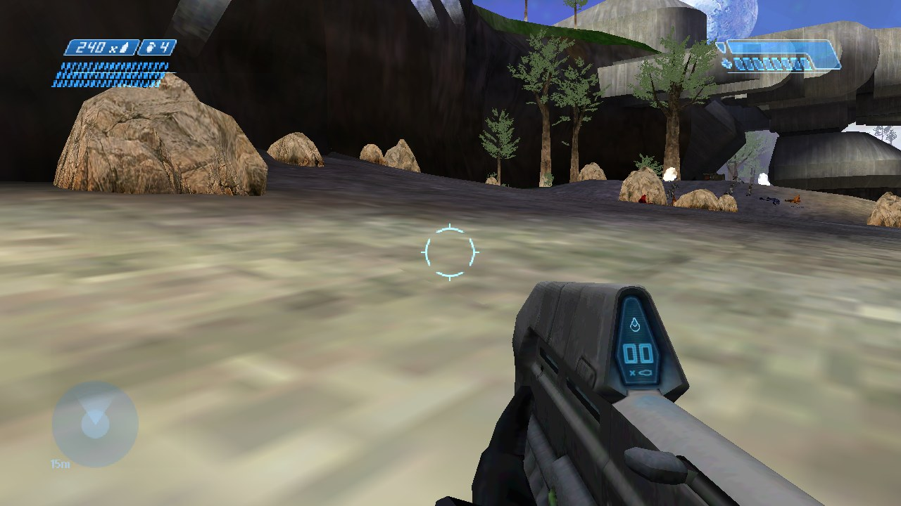</td>
<td>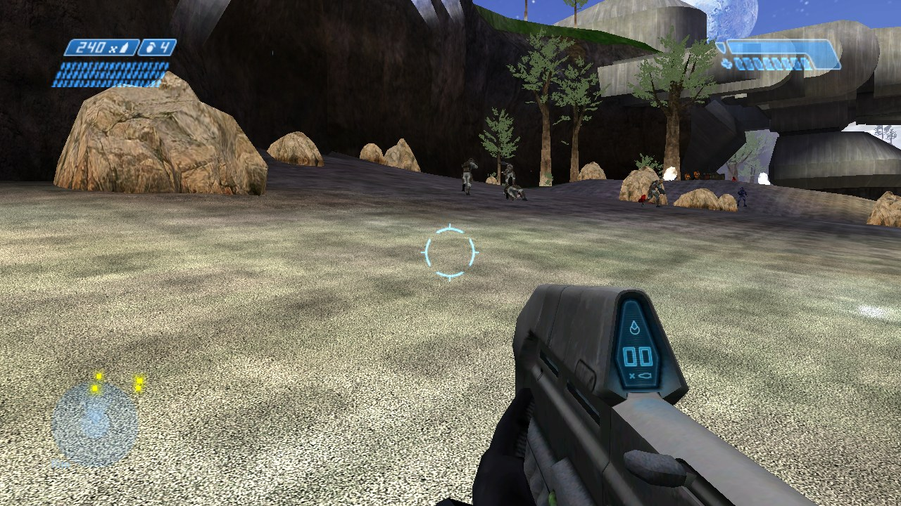</td>
<td></td>
</tr>
</table>

### 320x200 in 256 colours

DOS's default: VGA mode 13h, one palette made for each map, every pixel drawn by the processor.
Shown here four times larger, pixel for pixel.

<table>
<tr>
<td>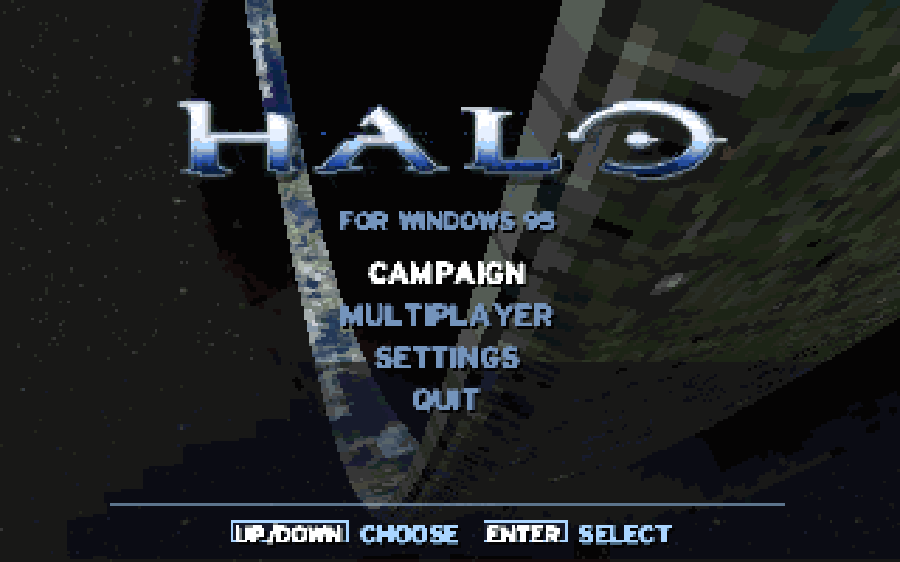</td>
<td>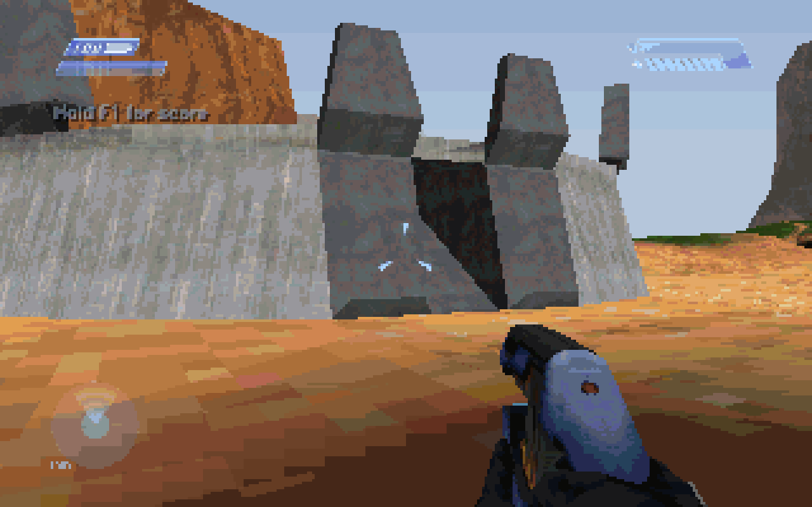</td>
<td>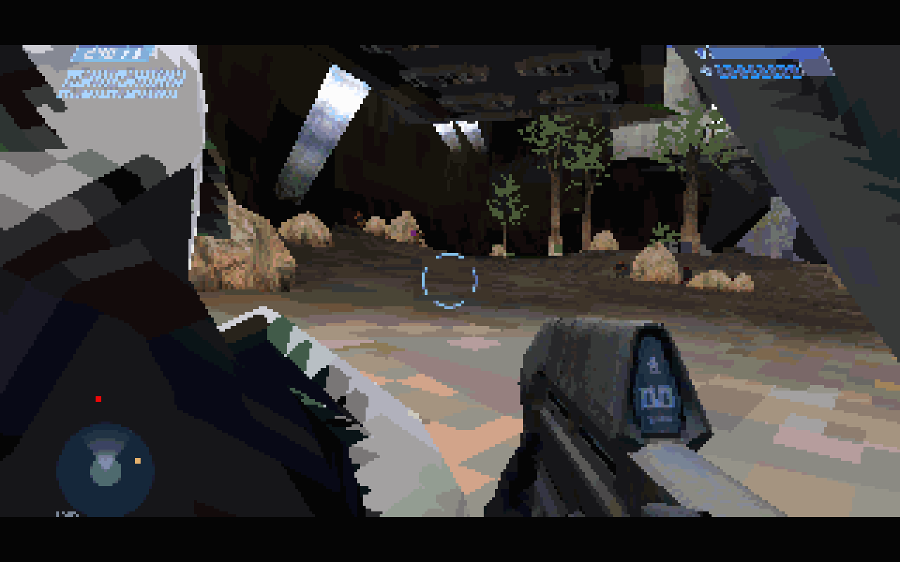</td>
</tr>
</table>

### More

<table>
<tr>
<td>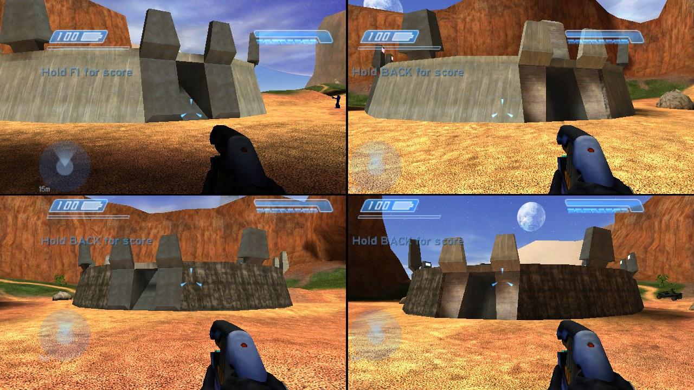<br><sub>Split screen for four: keyboard and mouse, controllers, joysticks</sub></td>
<td>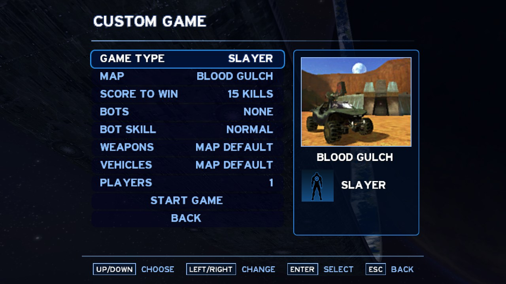<br><sub>Custom games with bots, on any map and game type</sub></td>
</tr>
<tr>
<td>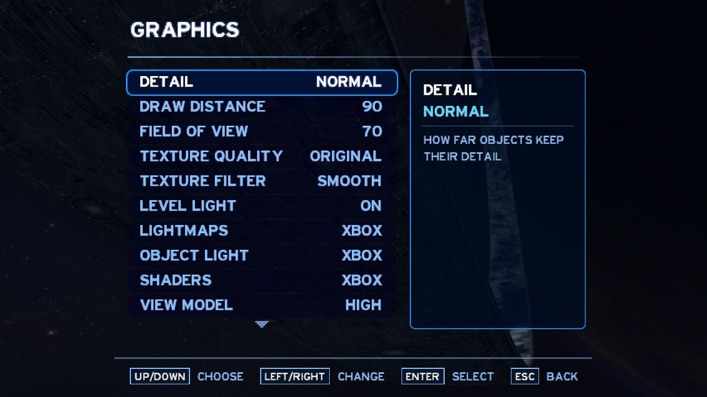<br><sub>Settings for everything from 8-bit colour to the Xbox look</sub></td>
<td>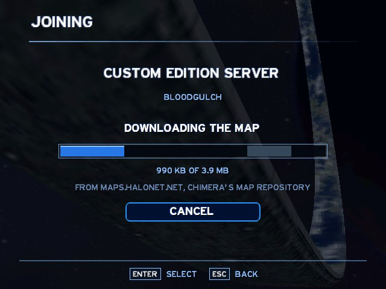<br><sub>Joining a Custom Edition server downloads its map</sub></td>
</tr>
<tr>
<td>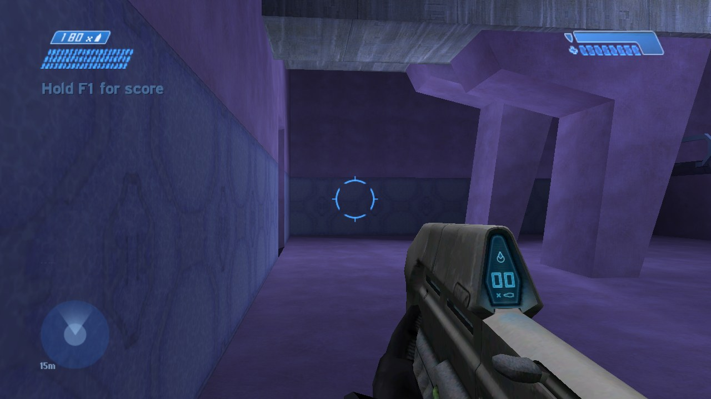<br><sub>Chill Out, OpenGL</sub></td>
<td>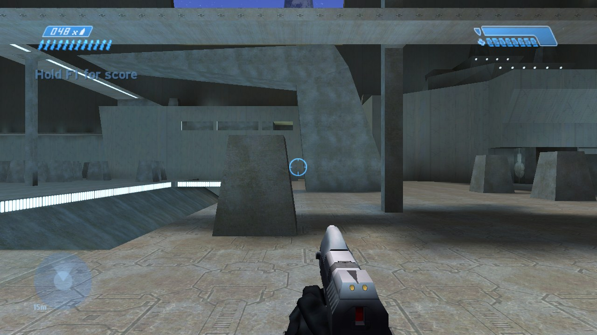<br><sub>Hang 'Em High, Direct3D 8</sub></td>
</tr>
</table>

## Features

- **The whole game.** All ten campaign levels with Halo's own scripts and cutscenes, two-player
  co-op, and the 13 multiplayer maps with every game type. Plus bots and Firefight (waves of the
  Covenant on a multiplayer map), after the Nintendo 64 port's.
- **Split screen** for two to four players. Each joins with a device of their own: keyboard and
  mouse, Xbox and XInput controllers, Windows joysticks, or the DOS game port's joysticks.
  Split-screen players can also play online together.
- **Online play.** The online game list that ChupathingyCE and OpenCE share, LAN games, invite links,
  Quick Join, and Halo Custom Edition 1.10 servers. A CE server's missing map is downloaded from the
  map repository [Chimera](https://github.com/SnowyMouse/chimera) uses.
- **Renderers:**
  - *Software*: 8, 16 or 32-bit colour from 320x200 up, with optional pixel doubling for slow machines.
  - *OpenGL 1.1* and *Direct3D 8*: full colour at any resolution, with Halo's detail maps.
  - *3dfx Voodoo Graphics* (DOS): a register-level driver of its own, no Glide needed.
- **Direct3D 8's Xbox look.** Halo's own lightmaps, objects lit from the light under them, the
  ground's detail maps and the skies' layered shaders mixed on the card as the Xbox's texture
  pass did. Each is a setting.
- **Wide screens.** Hor+ field of view, with the HUD in the screen's corners and the menus centred.
- **Settings for every machine.** Detail, draw distance, field of view (50-120), texture quality
  (32 pixels up to Halo's own), view-model detail, particles, the sky, the frame rate (30, 60, 120,
  uncapped) and an FPS counter.
- **Controls.** Every action rebindable to keys, mouse buttons and the wheel, plus the original
  game's controller settings: button and stick layouts, look sensitivity, invert, aim assist
  (off by default), aircraft controls and vibration.
- **Sound** through a Sound Blaster (16-bit stereo on an SB16) or Windows' wave mapper, with the
  music, dialogue and effects mixed by an integer mixer.

## Installing

### 1. Download

Get `halo-dos-<version>.zip` from the [latest release](https://github.com/JackTulli/halo-dos/releases/latest)
and unpack it. Everything is in its `HALO` folder:

| File | |
|---|---|
| `HALO.EXE` | the MS-DOS program |
| `HALO95.EXE` | the Windows program |
| `PLAY.BAT` | runs `HALO.EXE` on DOS, and again when the menu asks for a restart |
| `RUN-DOS.BAT`, `RUN-DOS-NET.BAT` | run `HALO.EXE` in DOSBox-X on a Windows PC |
| `RUN-WIN95.BAT` | runs `HALO95.EXE`, and asks once for your maps folder |
| `MAPS\`, `MAPS_CE\` | empty: your maps go here |
| `README.TXT` | the manual, for reading on DOS |
| `LICENSE.TXT`, `THIRDPTY.TXT` | the licences |

### 2. The maps

The game plays the maps of **Halo: Combat Evolved for the original Xbox**: the 24 `.map` files in the
`maps` folder of the game's disc (`ui.map`, the 13 multiplayer maps and the 10 campaign levels).
Any region works.

- **From a disc image** (`.iso` / `.xiso`) of your disc: open it with an Xbox image tool such as
  [extract-xiso](https://github.com/XboxDev/extract-xiso), and copy the `maps` folder's `.map`
  files into `HALO\MAPS`.
- **If you play ChupathingyCE**, its `maps` folder already holds the same files. Copy them, or give
  that folder to `RUN-WIN95.BAT` / `RUN-DOS.BAT` when they ask: they link it in as `MAPS`
  without copying anything.

Halo PC's maps are a different format and do not work in `MAPS`.

**Halo Custom Edition** (optional). For CE servers and CE maps, copy your Halo Custom Edition
`maps` folder into `MAPS_CE`. Every CE map needs `bitmaps.map`, `sounds.map` and `loc.map` from it.
CE maps you add there also show up in Custom Game's map list.

The first time a map is played it is unpacked into `CACHE\MAPS`. That takes about 35 MB for the
menu, 40-50 MB per multiplayer map and 100-270 MB per campaign level, and later starts use the
unpacked copy.

### 3. Run it

**On Windows (95 to 11):** run `RUN-WIN95.BAT`, or `HALO95.EXE` itself. Alt+Enter switches between
a window and the whole screen. On Windows 95, add Windows' TCP/IP if the game won't start
(Control Panel → Network → Add → Protocol → Microsoft → TCP/IP): the game needs `WSOCK32.DLL`
even to play alone.

**On a DOS machine:** boot MS-DOS 6.22 or 7.x, or use Windows 95/98's *Restart in MS-DOS mode*.
Load your mouse driver, then run `PLAY`. Optionally load your network card's packet driver first,
and have a Sound Blaster with its `BLASTER` variable set.

**In DOSBox-X on a PC:** install [DOSBox-X](https://dosbox-x.com) and run `RUN-DOS.BAT` (or
`RUN-DOS 133` to run as a 133 MHz Pentium). For networking in DOSBox-X, unpack DOSBox-X's
**MinGW** portable zip (`dosbox-x-mingw64-…-portable.zip` from
[its releases](https://github.com/joncampbell123/dosbox-x/releases)) into a folder named
`DOSBox-X` beside the game. That build has the *slirp* network, and the launcher gives the DOS
machine an NE2000 card and loads its packet driver. `RUN-DOS-NET HOST` hosts a game for the PCs
on your LAN. You can also point the `DOSBOX_X` environment variable at any `dosbox-x.exe`.

### What it needs

| | DOS (`HALO.EXE`) | Windows (`HALO95.EXE`) |
|---|---|---|
| Processor | Pentium with FPU; 133 MHz plays at 320x200, faster is better | Pentium or later |
| Memory | 64 MB (what it was tested with) | 64 MB |
| System | MS-DOS 6.22 / 7.x, or a DOS box | Windows 95 with TCP/IP, or later |
| Display | VGA (320x200x256); VESA 2.0 with a linear frame buffer for more | any; OpenGL 1.1 or DirectX 8.0a+ for the card renderers |
| Sound | Sound Blaster or compatible (optional) | any wave-out device (optional) |
| Network | a packet driver (optional) | Winsock (optional) |
| Disk | about 2 GB for the maps, plus the map cache | the same |

## Playing

The menu works with the keyboard (up/down, left/right, Enter, Escape), the mouse (point, click,
right-click for back, the wheel to scroll) and controllers (D-pad or stick, A, B).

```
CAMPAIGN      the ten levels, from The Pillar of Autumn to The Maw
MULTIPLAYER   ONLINE        quick join, browse games, host a game, players
              SPLIT SCREEN  two to four players on one screen
              CUSTOM GAME   any map and game type, with bots
              FIREFIGHT     waves of the Covenant on a multiplayer map
SETTINGS      PLAYER  DISPLAY  GRAPHICS  SOUND  CONTROLS  CONTROLLER
```

Some settings only take effect when the game starts: the renderer, resolution, colours, aspect,
double wide/tall, texture quality and sound on/off. They're marked `*` when changed, and
**APPLY AND RESTART** saves them and starts the game again. On DOS that needs the game to have
been started with `PLAY`.

**Default keys** (SETTINGS → CONTROLS changes them; each action takes up to three keys, mouse
buttons or wheel turns):

| Action | Keys | Action | Keys |
|---|---|---|---|
| Move | W A S D | Aim | mouse (or the arrows) |
| Fire | left button, Shift | Grenade | right button, G |
| Jump | Space, Enter | Melee | F, Backspace |
| Action | E | Reload | R |
| Switch weapon | Tab, mouse wheel | Switch grenades | X |
| Crouch | Left Ctrl, C | Zoom | Z, middle button |
| Flashlight | Q | Scores | F1 |
| Pause menu | Escape | | |

**Settings files:** `HALO.CFG` (Windows) and `HALODOS.CFG` (DOS) are written beside the programs
the first time, with every setting explained. Any setting can also be given on the command line,
as in `HALO95 -width 640 -height 480` or `HALO -play bloodgulch -bots 3`. DOS keeps only 126
characters of a command line, so put long lists in `HALODOS.CFG`.

### Renderers and the look

| Setting | What it does |
|---|---|
| RENDERER | SOFTWARE; OPENGL or DIRECT3D 8 (Windows); 3DFX VOODOO (DOS) |
| RESOLUTION, COLOURS | the picture's size, and 8, 16 or 32-bit colour (software) |
| DOUBLE WIDE / TALL | software: each pixel twice as wide or tall, for slow machines |
| ASPECT | AUTO, or 4:3 / 16:10 / 16:9 / 21:9 for a monitor that stretches the picture |
| DISPLAY, SCALING | Windows: window, full screen or exclusive mode; sharp, fill or stretch |
| TEXTURE QUALITY | LOWEST (32 px) to ORIGINAL (Halo's own sizes) |
| LIGHTMAPS / OBJECT LIGHT / SHADERS | Direct3D 8: XBOX draws as the Xbox did; VERTEX / FLAT / BAKED as OpenGL does |
| VIEW MODEL | the weapon in your hands at fewer triangles (faster), or off |
| FRAME RATE | 30 as Halo; 60, 120 or uncapped draw frames between the game's ticks |

`SHADERS XBOX` needs a card with three texture units or more (GeForce 3, Radeon 8500 and later);
other cards bake the detail into the textures.

Direct3D 8 draws Halo's water as Halo does: its moving ripple layers, the reflection of its cube map
in them, and its tints, which go from parallel to perpendicular with the viewing angle.
- **Pixel shaders 1.4** (Radeon 8500 and later): the tint is worked out per pixel from the ripples.
- **Pixel shaders 1.1–1.3** (GeForce 3, GeForce 4 Ti): the Xbox's own program, one tint a draw.

The `d3d_water` setting picks: 2 the best the card has, 1 the Xbox's way, 0 as OpenGL draws water.

## Playing online

MULTIPLAYER → ONLINE:

- **QUICK JOIN** joins the best game found: the most players short of full, then the shortest
  answer time.
- **BROWSE GAMES** lists LAN games, the online list's games and Halo Custom Edition servers.
  ChupathingyCE and OpenCE players and you can join each other. In the list:
  - left/right picks a tab: ALL, ONLINE, CHUPATHINGY, OPEN CE, CUSTOM EDITION, LAN;
  - Tab changes the sort;
  - F opens the filters (full, empty, joinable);
  - Q quick joins, R refreshes.
- **HOST A GAME** hosts on your LAN, and on the online list unless `network.host_public = false`.
  The game's invite link is written to `INVITE.TXT`. To join by a link, put it in `JOIN.TXT` beside
  the program before starting it.
- **PLAYERS** chooses who plays from this machine: split-screen players can join one online game
  together.

**Halo Custom Edition servers:** the game joins CE 1.10 servers as a Custom Edition client, with
Custom Edition's `bitmaps.map`, `sounds.map` and `loc.map` in `MAPS_CE`.
- **Map download:** if a server's map is missing, the JOINING page downloads it from the map
  repository Chimera uses and unpacks it (`map_download = 0` turns this off).
- **CD keys:** servers that check CD keys refuse this game.

**On DOS** the network needs a packet driver. Addresses come from DHCP, or from `net_address`,
`net_netmask`, `net_gateway` and `net_dns` in `HALODOS.CFG`. The online list needs the right time,
so DOS asks `pool.ntp.org`. If that fails, set `time_zone` to your hours from UTC.

## Troubleshooting

The programs write `HALO.LOG` (and `debug.txt`) beside themselves; a crash leaves where it happened
at the end of `HALO.LOG`. Please [open an issue](https://github.com/JackTulli/halo-dos/issues) with
the log, which program, the map and the machine.

| Problem | Fix |
|---|---|
| "There are no maps" | Put the Xbox maps in `MAPS` (see [The maps](#2-the-maps)). |
| Windows 95: the game doesn't start at all | Add TCP/IP (Control Panel → Network). |
| DOS: no sound | Set `sound_blaster = "A220 I5 D1 H5"` (your card's values) in `HALODOS.CFG`. |
| DOS: only 320x200 | Bigger modes need VESA 2.0 with a linear frame buffer (UniVBE on older cards). |
| OpenGL or Direct3D 8 falls back to software | `HALO.LOG` says why; the card renderers need OpenGL 1.1 or DirectX 8.0a. |
| Voodoo stays dark | Escape, then `renderer = software`; try `voodoo_clock = 45` or `voodoo_init = 0`. |
| A setting broke the picture | Delete `HALO.CFG` / `HALODOS.CFG`: the game writes new defaults. |

**Status.** Everything here has been played in Windows and in DOSBox-X. Real DOS machines and
real Voodoo cards are the least tested; reports from them are very welcome.

## Building from source

Builds run on a Windows 10 or 11 PC and produce both programs. You need:

| Tool | Notes |
|---|---|
| [LLVM for Windows](https://github.com/llvm/llvm-project/releases) | `clang`, `lld-link`, `llvm-lib`, `llvm-dlltool` (tried with 23.1; `winget install LLVM.LLVM`) |
| [Open Watcom 1.9](https://github.com/open-watcom/open-watcom-1.9/releases) | `wlink`, `wasm` and the DOS/32A extender, in `C:\WATCOM` or `WATCOM` |
| [nxdk](https://github.com/XboxDev/nxdk)'s sources | only for its PDCLib; in `~/nxdk` or `NXDK_DIR` |
| A Windows 10/11 SDK | its headers (`winget install Microsoft.WindowsSDK.10.0.22621`) |
| Python 3.10+ and [Ninja](https://ninja-build.org) | `winget install Python.Python.3.12 Ninja-build.Ninja` |
| Git | the game's submodule has long paths: `git config --global core.longpaths true` |

```powershell
git config --global core.longpaths true
git clone --recursive https://github.com/JackTulli/halo-dos
git clone https://github.com/XboxDev/nxdk $HOME\nxdk
git -C $HOME\nxdk submodule update --init lib/pdclib

cd halo-dos
python tools/dos_hooks.py          # the port's hooks into the game's sources (once)
python tools/dos_build.py          # writes build/dos/build.ninja
ninja -f build/dos/build.ninja dos win95 launchers
```

The programs land in `build/dos`; give that folder a `MAPS` folder and run them there.
`python tools/dos_package.py 0.1.0` packs a release zip (no maps, settings or logs) into
`build/release`.

Notes:
- `tools/dos_build.py --help` lists the options: `--llvm`, `--watcom`, `--nxdk`, `--sdk`.
- If Open Watcom's installer set `INCLUDE` and `LIB` for your account, clear them in the build's
  shell (`$env:INCLUDE = $null; $env:LIB = $null`): clang would read them.
- The submodule `chupathingyce` stays at ChupathingyCE's v0.8.0d commit. `tools/dos_hooks.py`
  makes the port's changes to it, and running it again changes nothing.
- `tools/dos_stubs.py` regenerates the stand-ins for game functions the port leaves out. Run it
  after adding or removing units.

### How it fits together

- **One game, two links.** The game is compiled once by clang for 32-bit Windows' ABI, for any
  Pentium (x87, no MMX or SSE). Open Watcom's `wlink` binds the objects to DOS/32A as a linear
  executable (`HALO.EXE`). `lld-link` makes a Windows 95 PE (`HALO95.EXE`) that imports only
  KERNEL32, USER32, GDI32, WINMM and WSOCK32.
- **One C runtime.** nxdk's PDCLib runs over KERNEL32. On DOS, `port/dos/dos/dos_kernel32.c`
  answers those KERNEL32 calls over DPMI and DOS, so the runtime and the platform code are the
  same on both systems.
- **The renderer** (`port/dos/render`) is the port's own: a software rasterizer, plus OpenGL,
  Direct3D 8 and Voodoo backends behind one table. `port/dos/game` connects it to the game's
  objects, HUD and menus.
- **The rest:**
  - `port/dos/xdk`: the Xbox SDK calls the game makes, over Win32, including DirectSound's mixer.
  - `port/dos/mtcp`: mTCP, moved to 32-bit DPMI.
  - `port/dos/retail`: the Halo Custom Edition client and the map downloader.

| Folder | |
|---|---|
| `chupathingyce/` | the game (submodule, ChupathingyCE v0.8.0d) |
| `port/dos/dos`, `port/dos/win95` | each system's own half: start-up, video, input, sound, network |
| `port/dos/render` | the renderers |
| `port/dos/game` | the game-side glue: menus, HUD, level and model drawing, bots, Firefight, split screen, online |
| `port/dos/retail` | Halo Custom Edition protocol, client, HTTP map download (`CE_PROTOCOL.md` documents the protocol) |
| `port/dos/xdk` | Xbox SDK calls over Win32 |
| `port/dos/mtcp` | mTCP (DOS TCP/IP) |
| `port/dos/launch`, `port/dos/release` | the launchers and the release's text files |
| `port/win9x`, `port/xbox`, `port/support` | the C runtime's pieces, Xbox map rebasing and texture decoding |
| `tools/` | `dos_build.py`, `dos_hooks.py`, `dos_stubs.py`, `dos_package.py`, profiling and protocol tools |
| `port/dos/d3d` | an experiment set aside: Halo's original renderer over an emulated Xbox Direct3D (`DIRECT3D.md`) |

## Credits and licences

- The game code is [ChupathingyCE](https://github.com/ChupathingyCE/chupathingyce)'s
  (GPL-3.0), which grew from halo-ce-universal. This port is GPL-3.0 as well: see [LICENSE](LICENSE).
- [mTCP](https://www.brutman.com/mTCP/) by Michael B. Brutman (GPL-3.0), the DOS TCP/IP stack.
- [DOS/32 Advanced DOS Extender](http://dos32a.narechk.net/) by Supernar Systems. *This product
  uses DOS/32 Advanced DOS Extender technology.*
- Direct3D 8's ps.1.4 water program follows [Irrlicht_Water_Shader](https://github.com/mahmoudgalal/Irrlicht_Water_Shader)
  by Mahmoud Galal (MIT; after ATI's RenderMonkey ocean water), fed with Halo's own ripples, cube map and tints.
- [Zstandard](https://github.com/facebook/zstd) (BSD), [musl](https://musl.libc.org)'s maths (MIT),
  [PDCLib](https://github.com/DevSolar/pdclib) via [nxdk](https://github.com/XboxDev/nxdk) (CC0),
  [KCP](https://github.com/skywind3000/kcp) (MIT), [Monocypher](https://monocypher.org)
  (CC0 / BSD-2-Clause), and Wine's Direct3D 8 headers (LGPL-2.1).
- Custom Edition maps are downloaded from the repository [Chimera](https://github.com/SnowyMouse/chimera) uses.
- Halo: Combat Evolved is © Microsoft. This project contains none of its data.

The release's `THIRDPTY.TXT` carries each licence's text.
